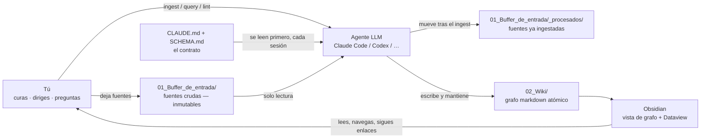

# Aeternea

Una base de conocimiento personal que un agente LLM construye y mantiene por ti.

Markdown plano. Se navega en [Obsidian](https://obsidian.md), se versiona en git y la escribe un CLI agéntico (Claude Code, Codex, OpenCode…). Tú curas las fuentes y preguntas; el agente hace el resumen, el referenciado cruzado, el archivado y la contabilidad.

> Obsidian es el IDE · el LLM es el programador · la wiki es el código base.

**[Read in English](README.md)**

> [!WARNING]
> Este vault está pensado para acabar guardando lo más personal de ti. **Tu copia, privada.** Usa *Use this template → Private*, o clónalo y apúntalo a un remoto privado. Nunca subas tu vault lleno a un repo público: limpiar los archivos después no limpia el historial de git.

## Por qué no basta con RAG

Lo habitual al juntar documentos y un LLM es recuperar trozos en el momento de la pregunta: el modelo redescubre tu conocimiento desde cero cada vez y no acumula nada. Aquí el agente **compila el conocimiento de forma incremental** en un grafo persistente e interconectado. Las referencias cruzadas ya existen. Las contradicciones ya están señaladas. La síntesis ya refleja todo lo que has metido.

Lo tedioso de una base de conocimiento no es leer ni pensar: es la contabilidad. La gente abandona sus wikis porque el mantenimiento crece más rápido que el valor. Un agente no se aburre y toca quince archivos en una pasada.

## Qué añade esta implementación

El patrón de fondo es el archivo de ideas *LLM Wiki* de Andrej Karpathy (ver [Créditos](#créditos)). Aeternea es una instanciación concreta y con opinión propia. Cada decisión es un compromiso deliberado:

- **El coste de descubrir crece con el número de entidades, no con el de nodos.** Toda búsqueda se filtra en el shell y solo el resultado entra en el contexto del modelo. Son tres capas: **L0** lista los nombres de los hubs una vez por sesión, una línea por persona o proyecto; **L1**, los hijos del único hub que tocas; **L2** abre un nodo. Un ingest sobre una persona cuesta lo mismo con 90 nodos que con 900, porque L1 solo paga los hijos de esa persona. *Coste:* el recall depende de que el agente haga el pre-flight, por eso es obligatorio.
- **Grafo atómico por punteros-padre.** Cada nodo guarda un nombre corto y `padre: "[[padre]]"`. El breadcrumb se calcula, nunca va en el nombre del archivo, así que renombrar un nivel intermedio no rompe a sus hijos. *Coste:* la jerarquía no se lee con un `ls`.
- **Vocabulario cerrado en el modelo de persona.** Los ejes de relación (`cercania`, `rol_dinamica`, `intensidad`) son enumeraciones fijas. El agente solo puede elegir valores de la lista; si la realidad no encaja, para y te pregunta. Es la garantía anti-alucinación de las vistas Dataview. *Coste:* a veces hay que enmendar el schema antes de poder registrar algo.
- **Salvaguarda fail-safe para lo emocional.** Cualquier marcador de escritura íntima o literaria (primera persona, un "tú", verso, una firma) envía la fuente a `literatura/` como un solo nodo inmutable, exento de todos los techos. Ante la duda, *se conserva intacto*. El modo de fallo debe ser "conservé de más", nunca "destruí una carta".
- **Identidad en 17 casillas fijas, versionadas sin borrar.** La información nueva actualiza una casilla y nunca crea otra, así que su coste es constante. Lo que deja de ser cierto baja a un histórico frío, append-only, con fechas y la evidencia que lo disparó. *"¿Cómo he cambiado?"* tiene respuesta trazable, y no cuesta nada mientras no lo preguntes.
- **Un lint determinista, con tests y hook pre-commit.** `_herramientas/lint_estructura.py` comprueba lo que no necesita juicio: frontmatter, vocabularios cerrados, punteros `padre`, procedencia de enlaces, enlaces rotos, techos de palabras y el contrato de evento entero. Pilla el fallo que se escapa con facilidad, un `padre: [[x]]` sin comillas: el grep lo sigue encontrando, pero Obsidian deja de tratarlo como enlace. El hook, opcional, lo pasa antes de cada commit y lo bloquea si hay un 🔴, si se toca un nodo `inmutable: true` o si un nodo cambia sin `última_actualización` de hoy.

**Probado en uso real:** su autor pasó este schema por ~6.900 entradas de historial de chats exportado, tres años (2023-2026) en 18 sesiones de ingest. Este repo es ese sistema sin ningún nodo personal.

## Arquitectura



| Capa | Regla |
|---|---|
| `01_Buffer_de_entrada/` | Fuentes crudas. El agente las lee y **nunca** las modifica. Tras un ingest exitoso se **mueven** a `_procesados/`, jamás se borran. |
| `02_Wiki/` | El grafo. El agente lo posee por completo. Tú lo lees. |
| `SCHEMA.md` | Las convenciones. Las coevolucionáis. Ante conflicto, manda SCHEMA. |

## Puesta en marcha

1. **Haz tu copia privada.** *Use this template → Private*, o:
   ```bash
   git clone https://github.com/YourRootkit/aeternea-template.git mi-wiki
   cd mi-wiki
   git remote remove origin
   ```
   Después activa el hook pre-commit (opcional, recomendado): `git config core.hooksPath _herramientas/hooks`.
2. **Abre la carpeta como vault** en Obsidian.
3. **Instala Dataview** (Ajustes → Plugins de la comunidad → Explorar → "Dataview"). `overview.md` e `index_personal.md` son paneles Dataview; sin el plugin se ven como bloques de código. Todo lo demás funciona en plano.
4. **Lee `_ejemplo/ingest-de-ejemplo.md`**: un ingest completo, de la fuente al log, con datos inventados. Después borra `_ejemplo/`.
5. **Deja tu primera fuente** en `01_Buffer_de_entrada/`.
6. **Abre tu agente en la raíz del repo** y dile:
   > Lee `CLAUDE.md` y `SCHEMA.md` enteros. Luego ejecuta el pre-flight e ingesta `01_Buffer_de_entrada/<mi-archivo>.md`. Enséñame el plan de atomización antes de escribir nada.

   En la primera sesión el agente te preguntará por el idioma y los vocabularios cerrados (`CLAUDE.md` → *Primera sesión*).
7. A partir de ahí: `ingest` · `query` · `lint`.

## Operaciones

- **Ingest.** Dejas una fuente y pides que la procese. El agente la clasifica (primero el fail-safe), te enseña el plan, la atomiza en hub + facetas/eventos/insights, enlaza las páginas nuevas en su índice, añade una entrada al log y mueve la fuente a `_procesados/`. Una sola fuente puede tocar 10-15 páginas.
- **Query.** Preguntas contra la wiki. El agente localiza los nodos con L0/L1, lee solo esos y responde con citas. Las buenas respuestas se archivan como nodos nuevos: las exploraciones componen en vez de morir en el historial del chat.
- **Lint.** Chequeo de salud periódico: contradicciones, afirmaciones caducadas, huérfanos, conceptos casi duplicados, más `python3 _herramientas/lint_estructura.py` para la parte determinista. Un barrido, un informe, agrupado por severidad.

## Estructura del repo

```
01_Buffer_de_entrada/    entran las fuentes crudas → _procesados/ tras el ingest
02_Wiki/                 el grafo: índices, overview, log, ramas técnica y personal
_plantillas/             andamios de nodo (el plugin Plantillas de Obsidian ya apunta aquí)
_herramientas/           lint determinista, sus tests y el hook pre-commit
.github/workflows/       pasa el lint y los tests en cada push (bórralo si no quieres CI)
_ejemplo/                un ingest resuelto — bórralo después de leerlo
CLAUDE.md · AGENTS.md    reglas de operación del agente (AGENTS.md apunta a CLAUDE.md)
SCHEMA.md                la especificación completa — léela para entender el sistema
```

Las carpetas con prefijo `_` son invisibles al sistema vivo: el pre-flight no las carga y el lint las ignora.

## Requisitos

- Un CLI agéntico que lea archivos y ejecute comandos (Claude Code, Codex, OpenCode…). En Windows, Git Bash o WSL: los comandos de descubrimiento son `grep`/`sed` POSIX.
- [Obsidian](https://obsidian.md) + el plugin Dataview, para navegar. Opcional pero recomendado.
- git. Python 3 + PyYAML para el lint (`pip install pyyaml`).

## Créditos

El patrón de fondo es el [gist *LLM Wiki* de Andrej Karpathy](https://gist.github.com/karpathy/442a6bf555914893e9891c11519de94f), un archivo de ideas pensado para pasárselo a tu propio agente. Léelo primero: explica el *porqué* mejor que cualquier README.

Aeternea añade sobre esa idea el grafo atómico, los vocabularios cerrados, los techos de palabras, el descubrimiento en tres capas, el versionado de identidad, la salvaguarda literaria y el lint determinista.

## Licencia

[MIT](LICENSE).
