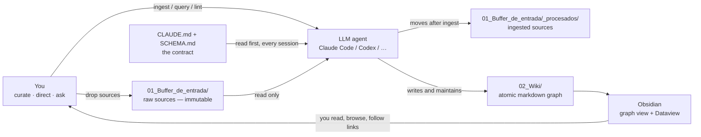

# Aeternea

A personal knowledge base that an LLM agent builds and maintains for you.

Plain markdown, browsed in [Obsidian](https://obsidian.md), versioned in git, written by an agentic CLI (Claude Code, Codex, OpenCode…). You curate sources and ask questions; the agent does the summarizing, cross-referencing, filing and bookkeeping.

> Obsidian is the IDE · the LLM is the programmer · the wiki is the codebase.

**[Leer en español](README.es.md)**

> [!WARNING]
> This vault is designed to end up holding the most personal things about you. **Keep your copy private.** Use *Use this template → Private*, or clone it and point it at a private remote. Never push your filled-in vault to a public repo: cleaning files later does not clean git history.

## Why not just RAG

The usual way to combine documents and an LLM is chunk retrieval at query time: the model rediscovers your knowledge from scratch on every question and nothing accumulates. Here the agent **compiles knowledge incrementally** into a persistent, interlinked graph. Cross-references already exist. Contradictions are already flagged. The synthesis already reflects everything you've fed it.

The tedious part of a knowledge base isn't reading or thinking — it's the bookkeeping. People abandon their wikis because maintenance grows faster than value. An agent doesn't get bored and touches fifteen files in one pass.

## What this implementation adds

The core pattern comes from Andrej Karpathy's *LLM Wiki* idea file (see [Credits](#credits)). Aeternea is one concrete, opinionated instantiation of it. Each choice below is a deliberate trade-off:

- **Discovery cost doesn't grow with the vault.** Every lookup is filtered in the shell, and only the result enters the model's context. Three layers: **L0** lists hub names once per session; **L1** lists the children of the one hub you're touching; **L2** opens one node. An ingest about a person costs the same at 90 nodes as at 900. *Cost:* recall depends on the agent running the pre-flight, so it's mandatory.
- **Atomic graph with parent pointers.** Each node stores a short name plus `padre: "[[parent]]"`. The breadcrumb is computed, never baked into filenames, so renaming a middle level doesn't break its children. *Cost:* you can't read the hierarchy with `ls`.
- **Closed vocabularies on the person model.** Relationship axes (`cercania`, `rol_dinamica`, `intensidad`) are fixed enums. The agent may only pick listed values. If reality doesn't fit, it stops and asks you. This is the anti-hallucination guarantee behind the Dataview views. *Cost:* sometimes you have to amend the schema before you can record something.
- **Fail-safe for emotional writing.** Any marker of intimate or literary text — first person, a "you", verse, a signature — routes the source to `literatura/` as one immutable node, exempt from every word ceiling. When in doubt, *keep it intact*. The failure mode must be "I kept too much", never "I destroyed a letter".
- **Identity in 17 fixed boxes, versioned without deleting.** New information updates a box and never creates a new one, so its cost stays constant. Whatever stops being true moves to a cold, append-only history with dates and the evidence that triggered the change. *"How have I changed?"* has a traceable answer, and costs nothing until you ask it.
- **A deterministic lint, with tests and a pre-commit hook.** `_herramientas/lint_estructura.py` checks what doesn't need judgment: frontmatter, closed vocabularies, parent pointers, link provenance, broken links, word ceilings and the full event contract. It catches the bug that's easy to miss, an unquoted `padre: [[x]]`: grep still finds it, but Obsidian no longer treats it as a link. The optional hook runs it before every commit and blocks the commit on a 🔴, on any edit to an `inmutable: true` node, or when a changed node doesn't carry today's `última_actualización`.

**Battle-tested:** the author ran this schema over ~6,900 entries of exported chat history spanning three years (2023–2026), across 18 ingest sessions. This repo is that system with every personal node removed.

## Architecture



| Layer | Rule |
|---|---|
| `01_Buffer_de_entrada/` | Raw sources. The agent reads them and **never** edits them. After a successful ingest they're **moved** to `_procesados/`, never deleted. |
| `02_Wiki/` | The graph. The agent owns it entirely. You read it. |
| `SCHEMA.md` | The conventions. You co-evolve them. On conflict, SCHEMA wins. |

## Quick start

1. **Make your private copy.** *Use this template → Private*, or:
   ```bash
   git clone https://github.com/YourRootkit/aeternea-template.git my-wiki
   cd my-wiki
   git remote remove origin
   ```
   Then turn on the pre-commit hook (optional, recommended): `git config core.hooksPath _herramientas/hooks`.
2. **Open the folder as a vault** in Obsidian.
3. **Install Dataview** (Settings → Community plugins → Browse → "Dataview"). `overview.md` and `index_personal.md` are Dataview dashboards; without it they show as code blocks. Everything else works as plain markdown.
4. **Read `_ejemplo/ingest-de-ejemplo.md`**: one complete ingest, from source to log, with made-up data. Delete `_ejemplo/` afterwards.
5. **Drop your first source** in `01_Buffer_de_entrada/`.
6. **Open your agent at the repo root** and say:
   > Read `CLAUDE.md` and `SCHEMA.md` in full. Then run the pre-flight and ingest `01_Buffer_de_entrada/<my-file>.md`. Show me the atomization plan before writing anything.

   On the first session the agent will ask about language and closed vocabularies (`CLAUDE.md` → *Primera sesión*).
7. From then on: `ingest` · `query` · `lint`.

## Operations

- **Ingest.** You drop a source and ask for it to be processed. The agent classifies it (fail-safe first), shows the plan, atomizes it into hub + facets/events/insights, links new pages in the right index, appends a log entry and moves the source to `_procesados/`. One source can touch 10–15 pages.
- **Query.** You ask against the wiki. The agent finds the relevant nodes through L0/L1, reads only those and answers with citations. Good answers get filed as new nodes, so explorations compound instead of dying in chat history.
- **Lint.** A periodic health check: contradictions, stale claims, orphans, near-duplicate concepts, plus `python3 _herramientas/lint_estructura.py` for the deterministic part. One sweep, one report, grouped by severity.

## Repo layout

```
01_Buffer_de_entrada/    raw sources in → _procesados/ after ingest
02_Wiki/                 the graph: indexes, overview, log, technical and personal branches
_plantillas/             node scaffolds (Obsidian core Templates plugin is pre-pointed here)
_herramientas/           deterministic lint, its tests and the pre-commit hook
.github/workflows/       runs the lint and the tests on every push (delete it if you don't want CI)
_ejemplo/                a worked ingest — delete after reading
CLAUDE.md · AGENTS.md    operating rules for the agent (AGENTS.md points to CLAUDE.md)
SCHEMA.md                the full specification — read this to understand the system
```

Folders prefixed with `_` are invisible to the live system: the pre-flight doesn't load them and the lint ignores them.

## Language

The schema, folder names and node vocabulary are **in Spanish** — it's the author's working language. Agents follow it fine in any language. To have nodes written in yours, change SCHEMA §13 (*Idioma*); field and folder names can stay as they are.

## Requirements

- An agentic CLI that can read files and run shell commands (Claude Code, Codex, OpenCode…). On Windows, use Git Bash or WSL: the discovery commands are POSIX `grep`/`sed`.
- [Obsidian](https://obsidian.md) + the Dataview plugin, to browse. Optional but recommended.
- git. Python 3 + PyYAML for the lint (`pip install pyyaml`).

## Credits

The underlying pattern is Andrej Karpathy's [*LLM Wiki* gist](https://gist.github.com/karpathy/442a6bf555914893e9891c11519de94f), an idea file meant to be handed to your own agent. Read it first: it explains the *why* better than any README.

Aeternea adds the atomic graph, closed vocabularies, word ceilings, three-layer discovery, identity versioning, the literary safeguard and the deterministic lint on top of that idea.

## License

[MIT](LICENSE).
